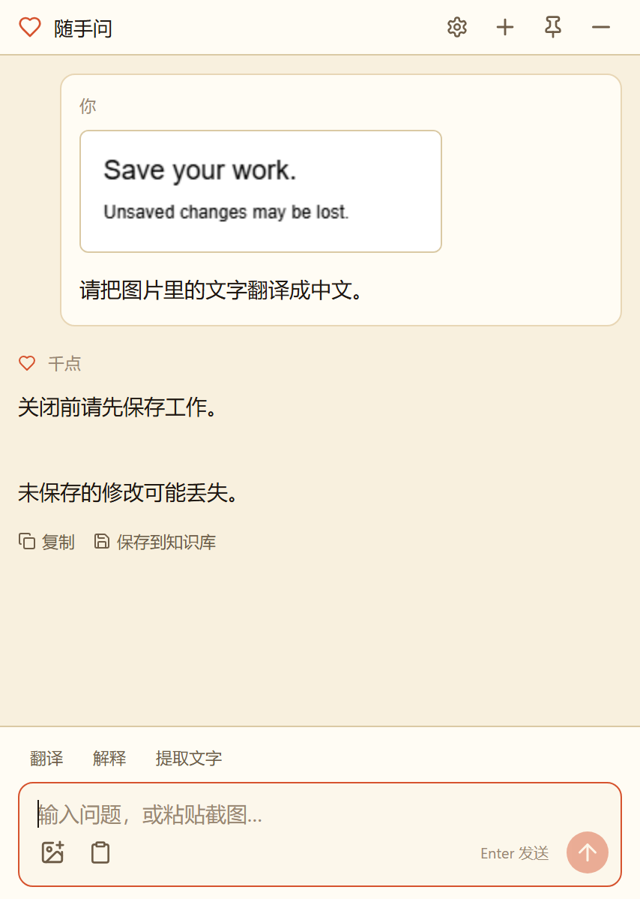
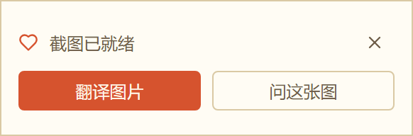
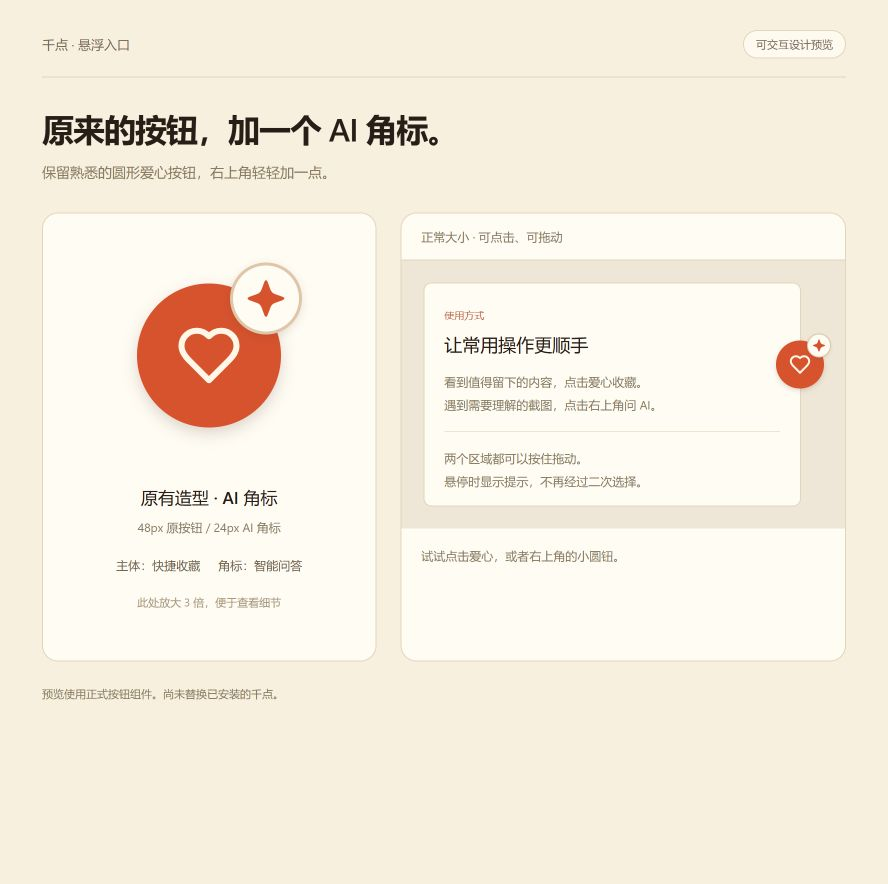

# 千点

管理你的碎片化知识~以标签体系为核心的桌面知识管理工具。从任何地方复制内容，点击悬浮按钮，打上标签，知识即刻入库。

> "一条一条的知识点，慢慢积累成千点。"


## 下载与更新

**[下载 Windows 64 位安装包](https://github.com/genudhfg3-dot/qiandian/releases/latest)** · [更新日志](CHANGELOG.md)

已有版本请先从系统托盘退出千点，再安装新版。安装升级会保留本地知识库与设置。

## 新增：随手问助手

截图之后，直接问这张图。把看不懂的内容弄明白，再把有用的问答留下来。

- **截图后随手问**：使用 Snipaste 等工具截图并复制，点击轻提示即可翻译或提问，不占用截图工具的 F1 快捷键。
- **看图翻译、解释与提取文字**：支持粘贴或拖入图片，也可以围绕同一张图连续追问。
- **有用的问答存进知识库**：编辑标题、正文和标签后保存，并可同时保留对话中的原始文字与截图，方便查找与复用。
- **日常入口更直接**：圆形爱心按钮用于快捷收藏，右上角星形角标直接打开助手，无需二次选择；两个区域都能按住拖动。
- **文字同样可以问**：直接输入问题，或选中知识正文里的文字进行翻译与答疑。

> **请使用支持图片理解（视觉／多模态）的大模型。** 纯文字模型无法处理截图。助手沿用「AI 设置」里的模型与 API Key；每位使用者需填写自己的配置。模型调用需要联网，并可能产生服务商费用；响应速度取决于网络与模型服务。

### 功能展示

以下助手界面使用公开测试文字演示，不包含个人知识库内容。

<table><tr><td align="center"><strong>截图问答与收藏</strong><br></td><td align="center"><strong>截图后的一键入口</strong><br><br><br>截图复制后显示轻提示，不抢占当前输入焦点。<br>可在 AI 设置中关闭提示。</td></tr></table>

<details><summary>查看悬浮按钮设计与操作示意</summary>



此图为使用正式组件渲染的交互预览，按钮周围的页面仅用于说明操作。

</details>

### 如何使用

1. 在「AI 设置」中启用 AI，填写接口地址、支持图片的模型和自己的 API Key。
2. 点击悬浮按钮右上角的星形角标，或按 **Alt + R** 打开助手。
3. 粘贴截图或文字，输入问题；也可直接点击翻译、解释或提取文字。
4. 遇到值得保留的答案，点击「保存到知识库」整理收藏。

默认助手快捷键为 `Alt+R`，可在设置中修改或恢复默认；升级时保留已经保存的快捷键。`Ctrl+Shift+K` 仍用于快捷收藏。

## 功能特性

- **一键捕获**：全局快捷键 `Ctrl+Shift+K` 或悬浮按钮，快速记录剪贴板内容
- **标签体系**：分类 · 标签两级结构，八色调色板，支持搜索和新建
- **来源追踪**：自动识别来源应用、窗口标题、URL
- **全文检索**：FTS5 全文搜索，覆盖标题、正文、摘要、来源
- **AI 元数据**（可选）：兼容 OpenAI 协议，自动生成标题、摘要、标签建议
- **本地优先**：知识库与图片保存在本机，离线可管理和检索；AI 功能需要连接你配置的模型服务

## 下一步更新计划

- **知识框架构建**：基于目前AI生成的题目、摘要、场景、关键词，构建知识框架（还没想好展现形式，可能是图谱）
- **AI检索与生成**：接入AI检索与内容生成
- **万序集成**：目前还在开发万序个人文件管理系统，可能会与本地文件管理进行集成

## 快速开始

前置：Node.js 20+ 与 npm；Windows 打包还需要 Python 3（better-sqlite3 编译依赖）。

```bash
npm install
npm run electron:dev   # 启动开发环境
```

若 better-sqlite3 / active-win 报错（常见于版本升级后），重编原生模块：

```bash
npm run rebuild:native
```

## 打包 Windows 安装包

```bash
npm run build          # 只产出 dist / dist-electron
npm run package:win    # 产出 release/千点-*-x64.exe
```

打包期间 exe 若被 Windows Defender 短暂锁，等 30-60 秒重跑；
或加 `--config.directories.output=<OneDrive 之外的路径>` 换个输出目录。

## 目录结构

```
src/            React + TypeScript 渲染进程
electron/       Electron 主进程 + preload
scripts/        构建 / 验证 / 打包脚本
build/          NSIS 打包资源 (app.ico)
docs/           开发笔记
PRD.md          产品需求文档
```

## 数据位置

Windows 默认数据目录为 `%APPDATA%\personal-knowledge-base\`，知识库与图片不会随源码或安装包分发。请勿将自己的数据目录一并分享。

Windows 系统加密可用时，API Key 使用 Electron safeStorage 加密保存，设置页面只显示是否已配置。截图轻提示不会自动把图片发送给模型；主动发送或点击翻译后，相关内容会提交到你配置的模型服务。

## 技术栈

- Electron 42 + React 19 + TypeScript
- Vite + Tailwind CSS 4
- better-sqlite3（本地存储）
- turndown（HTML → Markdown）
- active-win（来源应用识别）

## 许可证

[GPL-3.0](LICENSE)
